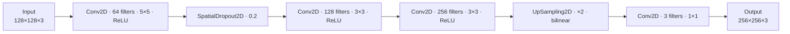

<div align="center">

# 🖼️ Image Super-Resolution with Deep Learning

### Upscaling 128×128 images to 256×256 with a Convolutional Autoencoder in Keras


*Give blurry, downscaled photos their detail back — one convolution at a time.*

</div>

---

## ✨ Overview

**Super-resolution (SR)** is the task of reconstructing a high-resolution (HR) image from its low-resolution (LR) counterpart — effectively "hallucinating" plausible fine detail that was lost during downscaling. It is used in photo enhancement, medical imaging, satellite imagery, and video streaming.

This project trains an **encoder-free convolutional autoencoder** end-to-end with Keras / TensorFlow:

- Takes a **128 × 128 × 3** RGB image as input
- Extracts features through stacked convolutional layers
- Upsamples the feature map **2×** with bilinear interpolation
- Projects back to RGB, producing a **256 × 256 × 3** image
- Optimizes the **Huber loss** (robust to outliers, smoother than plain MSE near zero)

The whole pipeline — data loading, preprocessing, training and model persistence — lives in three small, readable scripts.

---

## 📦 Dataset

The training data comes from the public Kaggle dataset
**[Image Super Resolution](https://www.kaggle.com/datasets/adityachandrasekhar/image-super-resolution)** by *Aditya Chandrasekhar* — a collection of paired low-quality / high-quality images built specifically for training models that convert low-quality images into high-quality ones.

The archive ships with `train` and `val` folders, each containing `high_res` and `low_res` subdirectories. This project expects the extracted images arranged as:

```
SR/
├── low_res/    ← low-resolution source images (resized to 128 × 128)
└── high_res/   ← matching high-resolution targets (resized to 256 × 256)
```

**Getting the data**

```bash
# Option 1 — Kaggle CLI
kaggle datasets download -d adityachandrasekhar/image-super-resolution
unzip image-super-resolution.zip -d SR/

# Option 2 — download manually from
# https://www.kaggle.com/datasets/adityachandrasekhar/image-super-resolution
```

**Preprocessing** (done automatically in `main.py`):

| Step | Detail |
|------|--------|
| Loading | Every image is opened with Pillow and converted to **RGB** |
| Resizing | LR → 128 × 128, HR → 256 × 256 |
| Normalization | Pixel values scaled to **[0, 1]** (divide by 255) |
| Pairing | Files are read in **sorted filename order**, so LR/HR pairs stay aligned |
| Splitting | 80 % train / 20 % test (`random_state=1`), plus 10 % of train held out for validation |

---

## 🧠 Model Architecture



| # | Layer | Configuration | Output Shape | Params |
|---|-------|---------------|--------------|-------:|
| 1 | `Input` | RGB image | 128 × 128 × 3 | — |
| 2 | `Conv2D` | 64 filters, 5 × 5, ReLU, same padding | 128 × 128 × 64 | 4,864 |
| 3 | `SpatialDropout2D` | rate 0.2 | 128 × 128 × 64 | — |
| 4 | `Conv2D` | 128 filters, 3 × 3, ReLU, same padding | 128 × 128 × 128 | 73,856 |
| 5 | `Conv2D` | 256 filters, 3 × 3, ReLU, same padding | 128 × 128 × 256 | 295,168 |
| 6 | `UpSampling2D` | factor 2 × 2, bilinear | 256 × 256 × 256 | — |
| 7 | `Conv2D` | 3 filters, 1 × 1, linear | 256 × 256 × 3 | 771 |
| | **Total** | | | **374,659** |

**Design notes**

- All convolutions use `padding='same'`, so spatial size is preserved until the single upsampling step doubles it — the network never has to fight with shrinking feature maps.
- `SpatialDropout2D` drops entire feature maps instead of individual pixels, which regularizes convolutional stacks more effectively than standard dropout.
- A lightweight **1 × 1 convolution** after upsampling maps the 256-channel feature space back to the 3 RGB channels, keeping the output head cheap.

---

## ⚙️ Training Configuration

| Setting | Value |
|---------|-------|
| Optimizer | `Adam` (default learning rate) |
| Loss | `Huber` |
| Metrics | `MAE` |
| Max epochs | 100 |
| Batch size | 16 |
| Train / test split | 80 % / 20 % (`random_state=1`) |
| Validation split | 10 % of the training set |
| `EarlyStopping` | monitors `val_loss`, patience 10, **restores best weights** |
| `ReduceLROnPlateau` | monitors `val_loss`, patience 5, halves the LR on plateau |

Training stops automatically when validation loss stops improving, so the model never overfits past its best checkpoint — the restored weights are always the best-scoring ones.

---

## 🚀 Getting Started

### 1. Install dependencies

```bash
pip install -r requirments.txt
```

> 📝 The requirements file is intentionally named `requirments.txt` (sic) in this repo — keep the name consistent if you rename it.

### 2. Add the dataset

Download the dataset from [Kaggle](https://www.kaggle.com/datasets/adityachandrasekhar/image-super-resolution) and place the images in `SR/low_res/` and `SR/high_res/` as shown above.

### 3. Train

```bash
python main.py
```

`main.py` loads and preprocesses the images, builds the model, and runs the training loop with early stopping and LR scheduling.

### 4. Save & reuse the trained model

After training, persist the model so it can be reloaded later without retraining:

```python
model.save("super_resolution.keras")   # add this at the end of main.py
```

Then load it anywhere with the provided helper:

```python
from load_model import load_model

model = load_model()          # reads 'super_resolution.keras'
high_res = model.predict(low_res_batch)   # (N, 256, 256, 3) in [0, 1]
```

To visualize a prediction:

```python
from PIL import Image
Image.fromarray((high_res[0] * 255).clip(0, 255).astype("uint8")).show()
```

---

## 📁 Project Structure

```
.
├── main.py             # data loading, preprocessing, training loop
├── model.py            # build_model() — the CNN architecture
├── load_model.py       # load_model() — reload a saved .keras model
├── requirments.txt     # pinned dependencies
├── super_resolution.keras   # saved model (created after training)
└── SR/                 # dataset (download from Kaggle)
    ├── low_res/
    └── high_res/
```

---

## 📋 Requirements

| Package | Version |
|---------|--------:|
| TensorFlow | 2.21.0 |
| NumPy | 2.5.3 |
| pandas | 3.0.6 |
| scikit-learn | 1.9.1 |
| Pillow | 12.3.0 |

---

## 🙏 Acknowledgements

- **[Image Super Resolution](https://www.kaggle.com/datasets/adityachandrasekhar/image-super-resolution)** dataset by [Aditya Chandrasekhar](https://www.kaggle.com/adityachandrasekhar) on Kaggle.
- Built with [TensorFlow](https://www.tensorflow.org/) / [Keras](https://keras.io/), [scikit-learn](https://scikit-learn.org/) and [Pillow](https://python-pillow.org/).

---

<div align="center">

⭐ *If this project helped you, a star is always appreciated!*

</div>
